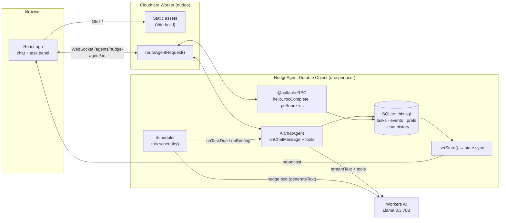
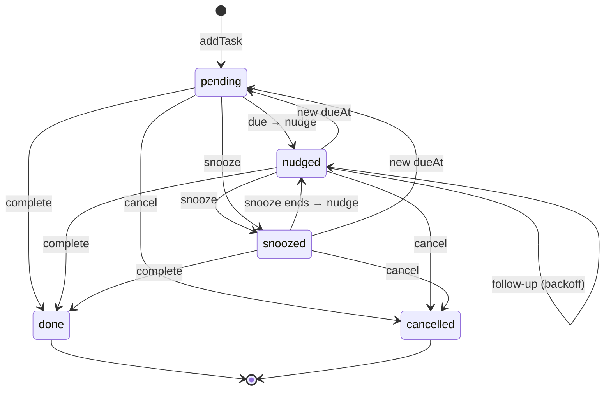

# Nudge 🔔

**A personal follow-up agent that keeps reminding you, a little more firmly each time, until things are actually done.**

Built on the [Cloudflare Agents SDK](https://developers.cloudflare.com/agents/), Durable Objects and Llama 3.3 on Workers AI. No external API keys.

**▶ Live demo: [nudge-agent.bathanid888.workers.dev](https://nudge-agent.bathanid888.workers.dev/)**

---

## Demo

Try it at **https://nudge-agent.bathanid888.workers.dev/**. No sign-up: each browser gets its own private agent (see [Identity](#design-decisions-and-trade-offs)).

1. Type “Remind me in 2 minutes to drink a glass of water” and allow notifications when asked.
2. Wait for the 🔔 nudge to arrive (toast + system notification) and appear in the chat.
3. Click **Snooze 15m**, then **Done** in the side panel, or just type “done”.

> 📸 _Screenshot / GIF placeholder: add `docs/demo.gif` here._

## What it does

You chat in plain language:

- “Remind me to pay rent on the 1st and keep nudging until I confirm”
- “Follow up with Priya on Friday if I haven't heard back”
- “Snooze that for an hour” · “I paid it” · “Quiet hours 23:00 to 6:30”

Nudge turns that into structured tasks, then **follows up on its own**: when a task comes due it posts a reminder into the chat, then keeps re-nudging with growing urgency (gentle → firm → urgent), honours snoozes and quiet hours, and stops only when the task is done or cancelled. It works for anyone: students, parents, freelancers, managers.

What sets it apart from a reminder app is that it **follows up autonomously** and **learns your habits**: it notices that morning reminders get snoozed, how long you usually snooze, and how quickly you act after a nudge, then adapts.

## Features

- 💬 **Streaming chat** with Llama 3.3 (70B, fp8-fast) and tool calling: add, list, update, snooze, complete and cancel tasks, get a briefing, set preferences.
- 🔁 **Autonomous follow-ups** driven by the agent scheduler: exponential backoff (15 min → 1 h → 3 h → daily), capped per task.
- 📈 **Escalating tone**: each nudge is written by the LLM for its level (friendly → direct → short and insistent), with a safe template fallback.
- 🧭 **Explicit state machine**: `pending → nudged → snoozed → done` (plus `cancelled`), enforced in one pure function.
- 🌙 **Quiet hours**: nudges that would land at night are deferred to the end of the window.
- ☀️ **Daily briefing** at your chosen local time: overdue, due today, snoozed.
- 🔄 **Recurring tasks** (daily/weekly/monthly, DST-safe, month-end aware): completing one schedules the next.
- 🧠 **“What Nudge has learned”**: deterministic habit learning from an events log, fed back into behaviour and the system prompt.
- 📋 **Live task panel**: Overdue / Today / Upcoming / Snoozed / Done, with one-click Done / Snooze 15m · 1h · Tomorrow / Cancel over RPC. Updates in real time via state sync.
- 🔔 **Browser notifications + in-app toasts** when a nudge arrives.
- 🌗 Light/dark, responsive (the panel becomes a drawer on mobile), keyboard and screen-reader friendly.
- 🗑️ **Reset my data**: wipes tasks, events, preferences, chat and pending schedules.

## Architecture



**Flow of a nudge:** `addTask` validates the time, writes the row and calls `this.schedule(dueAt, "onTaskDue", { taskId, seq })`. When the alarm fires, `onTaskDue` re-reads the task, checks it is still active and the `seq` still matches, defers if inside quiet hours, asks Llama for a one-line reminder in the right tone (falls back to a template), persists it as an assistant chat message, logs a `nudged` event, moves the task to `nudged`, schedules the next follow-up, and pushes the new state plus a `nudge/fired` event to every open tab.

### Task lifecycle



| Nudge # | Gap before next | Tone (persistence = gentle) | Tone (firm) | Tone (urgent) |
| ------- | --------------- | --------------------------- | ----------- | ------------- |
| 1       | 15 min\*        | gentle                      | firm        | urgent        |
| 2       | 1 h             | gentle                      | firm        | urgent        |
| 3       | 3 h             | firm                        | urgent      | urgent        |
| 4       | 1 day           | firm                        | urgent      | urgent        |
| 5+      | 1 day           | urgent                      | urgent      | urgent        |

Default caps: gentle 3, firm 5, urgent 8 nudges (override with `maxNudges`, 1–20). \*Once Nudge has learned your typical response time, the first gap becomes 1.5× that (15–180 min).

## Code architecture

The code is split into layers. Each layer depends only on the layers below it, and the domain rules sit at the bottom with no Cloudflare imports:

```
 Browser   src/client.tsx → src/app/App.tsx (+ components/, identity.ts, useNotifications.ts)
              │  useAgent (WebSocket: state sync + RPC)   useAgentChat (streaming chat)
              ▼
 Worker    src/server.ts  default export fetch() → routeAgentRequest() ─ else ─▶ static assets
              ▼
 Agent     src/server.ts  NudgeAgent extends AIChatAgent   (one Durable Object per user)
              │  onChatMessage · @callable RPC · onTaskDue / onBriefing · syncState
              ├──▶ src/tools.ts      LLM tools → NudgeService methods on the agent
              ├──▶ src/db.ts         NudgeStore: SQL repository + migrations
              ├──▶ src/lib/aiStream.ts  Workers AI stream fix (see Deviations)
              ▼
 Domain    src/lib/{tasks,time,habits,prompts,types}.ts   pure functions, unit tested
```

| Layer            | Files                                                     | Responsibility                                                                                                                                                                                                                                                                                                                                                                                                                                                       |
| ---------------- | --------------------------------------------------------- | -------------------------------------------------------------------------------------------------------------------------------------------------------------------------------------------------------------------------------------------------------------------------------------------------------------------------------------------------------------------------------------------------------------------------------------------------------------------- |
| **Client**       | [`src/client.tsx`](src/client.tsx), [`src/app/`](src/app) | React 19 SPA. [`identity.ts`](src/app/identity.ts) creates an anonymous per-browser id that names the user's agent. `useAgent` opens the WebSocket, receives `NudgeState` pushes for the task panel and calls `@callable` methods (Done, Snooze, Cancel, Reset). `useAgentChat` streams the chat. `App.tsx` turns `nudge/fired` and `nudge/briefing` broadcasts into toasts and, through [`useNotifications.ts`](src/app/useNotifications.ts), system notifications. |
| **Worker entry** | [`src/server.ts`](src/server.ts) (bottom)                 | `routeAgentRequest()` forwards `/agents/nudge-agent/:id` to that user's Durable Object. Every other path is served by Static Assets (the Vite build), with SPA fallback.                                                                                                                                                                                                                                                                                             |
| **Agent**        | [`src/server.ts`](src/server.ts)                          | `NudgeAgent` owns one user's world. **Chat:** `onChatMessage` builds the system prompt (local time, prefs, learnings, open tasks), then streams Llama 3.3 with tools. **RPC:** `hello`, `rpcAddTask`, `rpcComplete`, `rpcSnooze`, `rpcCancel`, `rpcSetPreferences`, `resetMyData`. **Autonomy:** `onTaskDue` and `onBriefing` run from the scheduler. **Sync:** `syncState()` pushes the panel view after every change.                                              |
| **Tools**        | [`src/tools.ts`](src/tools.ts)                            | `addTask`, `listTasks`, `updateTask`, `snoozeTask`, `completeTask`, `cancelTask`, `getBriefing`, `setPreferences`. Zod schemas plus lenient input normalisation for Llama. Tools call a `NudgeService` interface, implemented by the agent, so the chat and the side panel go through the same code paths.                                                                                                                                                           |
| **Persistence**  | [`src/db.ts`](src/db.ts)                                  | `NudgeStore` over the agent's SQLite: `tasks`, `events` (append-only log used for learning) and `prefs`, with versioned, idempotent migrations. It receives the `sql` tag as a parameter, so it doesn't import the platform.                                                                                                                                                                                                                                         |
| **Domain**       | [`src/lib/`](src/lib)                                     | State machine and backoff (`tasks.ts`), time-zone math, quiet hours and cron derivation (`time.ts`), habit learning (`habits.ts`), prompts and template nudges (`prompts.ts`), shared types (`types.ts`). Has no Cloudflare imports and is covered by the Vitest suite.                                                                                                                                                                                              |

**A chat turn, end to end:**

1. The browser sends the message over the agent WebSocket, with its IANA timezone in the body.
2. The Worker routes it to the user's `NudgeAgent`, and `AIChatAgent` persists it to SQLite.
3. `onChatMessage` builds the system prompt and calls `streamText` against Workers AI, sending the last 24 messages and the tools.
4. Llama calls tools such as `addTask`. These validate the input, write to SQLite, call `this.schedule(...)` and call `syncState()`.
5. Tokens stream back to the browser, and the panel updates from the state push at the same time.

## Where Cloudflare is used

Everything runs on Cloudflare. There is no other backend, database, queue or cron service.

| Cloudflare product                                   | What Nudge uses it for                                                                                                                                                                                                         | Where                                                                                                                                                       |
| ---------------------------------------------------- | ------------------------------------------------------------------------------------------------------------------------------------------------------------------------------------------------------------------------------ | ----------------------------------------------------------------------------------------------------------------------------------------------------------- |
| **Workers**                                          | Hosts the whole app at `*.workers.dev`. The `fetch` handler routes agent traffic and falls through to static assets.                                                                                                           | [`src/server.ts`](src/server.ts) (`export default`), [`wrangler.jsonc`](wrangler.jsonc) (`main`)                                                            |
| **Workers Static Assets**                            | Serves the Vite-built React SPA from the same Worker, with `single-page-application` fallback. `run_worker_first: ["/agents/*"]` sends agent requests to the Worker code first.                                                | [`wrangler.jsonc`](wrangler.jsonc) (`assets`)                                                                                                               |
| **Durable Objects**                                  | One `NudgeAgent` instance per user. It is the WebSocket endpoint for chat, RPC and state sync, and it runs single-threaded, which keeps task updates race-free.                                                                | [`src/server.ts`](src/server.ts) (`NudgeAgent`), [`wrangler.jsonc`](wrangler.jsonc) (`durable_objects`)                                                     |
| **Durable Object SQLite storage**                    | Tasks, events and preferences (`this.sql`), the chat history (persisted by `AIChatAgent`) and the scheduler's own table.                                                                                                       | [`src/db.ts`](src/db.ts), [`wrangler.jsonc`](wrangler.jsonc) (`migrations` → `new_sqlite_classes`)                                                          |
| **Durable Object Alarms** (via the Agents scheduler) | `this.schedule(date, …)` for due reminders, backoff follow-ups and snooze wake-ups. `this.schedule(cron, …)` for the daily briefing. The agent wakes up even with no tab open.                                                 | [`src/server.ts`](src/server.ts) (`scheduleTaskAt`, `onTaskDue`, `ensureBriefingSchedule`, `onBriefing`)                                                    |
| **Workers AI**                                       | Llama 3.3 70B (`@cf/meta/llama-3.3-70b-instruct-fp8-fast`) through the `AI` binding: streaming chat with tool calling, and one-line nudge texts in the right tone. Session affinity routes a user's turns to the same replica. | [`src/server.ts`](src/server.ts) (`onChatMessage`, `composeNudge`), [`src/lib/aiStream.ts`](src/lib/aiStream.ts), [`wrangler.jsonc`](wrangler.jsonc) (`ai`) |
| **Agents SDK** (`agents`, `@cloudflare/ai-chat`)     | `AIChatAgent`, `routeAgentRequest`, `@callable` RPC, `setState`/`broadcast`, `schedule`, `persistMessages`. On the client: `useAgent` and `useAgentChat`.                                                                      | [`src/server.ts`](src/server.ts), [`src/app/App.tsx`](src/app/App.tsx)                                                                                      |
| **Cloudflare Vite plugin**                           | `npm run dev` runs the Worker and Durable Object in the real `workerd` runtime locally, and proxies the `AI` binding to your account (`remote: true`).                                                                         | [`vite.config.ts`](vite.config.ts)                                                                                                                          |
| **Workers Observability**                            | Logs and errors from the deployed Worker, viewable in the dashboard.                                                                                                                                                           | [`wrangler.jsonc`](wrangler.jsonc) (`observability`)                                                                                                        |
| **Kumo** (`@cloudflare/kumo`)                        | Cloudflare's React component library, used for the UI.                                                                                                                                                                         | [`src/app/`](src/app)                                                                                                                                       |
| **Workers Builds** (optional)                        | Git-connected deploys from GitHub (see [Deploy](#deploy)).                                                                                                                                                                     | Cloudflare dashboard                                                                                                                                        |

## The four required components

| Requirement                    | How                                                                                                                                                                                                          | Files                                                                                                                                                        |
| ------------------------------ | ------------------------------------------------------------------------------------------------------------------------------------------------------------------------------------------------------------ | ------------------------------------------------------------------------------------------------------------------------------------------------------------ |
| **1. LLM**                     | Llama 3.3 70B (`@cf/meta/llama-3.3-70b-instruct-fp8-fast`) via the `AI` binding and `workers-ai-provider`; streaming chat with tool calling, plus short nudge texts.                                         | [`src/server.ts`](src/server.ts) (`onChatMessage`, `composeNudge`), [`src/lib/prompts.ts`](src/lib/prompts.ts), [`wrangler.jsonc`](wrangler.jsonc)           |
| **2. Workflow / coordination** | Agent scheduler (`this.schedule`) drives due reminders, backoff follow-ups, snooze wake-ups and a cron daily briefing. Explicit state machine + escalation levels. Idempotent callbacks.                     | [`src/server.ts`](src/server.ts) (`onTaskDue`, `onBriefing`, `scheduleTaskAt`), [`src/lib/tasks.ts`](src/lib/tasks.ts), [`src/lib/time.ts`](src/lib/time.ts) |
| **3. User input (chat)**       | Streaming React chat (`useAgentChat`) served as static assets from the same Worker; side panel actions via `@callable` RPC; live state via `useAgent`.                                                       | [`src/app/App.tsx`](src/app/App.tsx), [`src/app/components/`](src/app/components), [`src/client.tsx`](src/client.tsx), [`src/tools.ts`](src/tools.ts)        |
| **4. Memory / state**          | The agent's embedded SQLite (`this.sql`): `tasks`, `events`, `prefs` tables with versioned, idempotent migrations; chat history persisted by `AIChatAgent`; derived state synced to clients with `setState`. | [`src/db.ts`](src/db.ts), [`src/lib/habits.ts`](src/lib/habits.ts), [`src/server.ts`](src/server.ts) (`syncState`)                                           |

## Run it locally

Requirements: Node 22+, a (free) Cloudflare account.

```bash
npm install
npx wrangler login     # once: Workers AI runs on Cloudflare even in local dev
npm run dev            # http://localhost:5173
```

Workers AI has no local emulator, so `wrangler.jsonc` marks the `AI` binding `"remote": true` (as the official starter does) and `npm run dev` proxies model calls to your account. Everything else (Durable Object, SQLite, scheduler, assets) runs locally.

**No Cloudflare login?** `npm run dev:offline` boots the whole app with remote bindings turned off. Chat replies show a friendly "model unavailable" message, but tasks, scheduling, nudges (template text), the panel, notifications and reset all work.

### Tests and checks

```bash
npm test               # Vitest unit tests for all pure logic (state machine, backoff, quiet hours, recurrence, dueAt validation, habits, prompts)
npm run typecheck      # tsc --noEmit (strict)
npm run lint           # oxlint
npm run build          # vite build → dist/
npm run check          # format + lint + typecheck + tests (what CI runs)

# End-to-end check of the autonomous loop against a running dev server (no LLM needed):
npm run dev:offline    # terminal 1
npm run smoke          # terminal 2
```

`npm run smoke` connects over WebSocket like the browser does, creates tasks via RPC, waits for a real scheduled nudge to fire, and checks state transitions, backoff, message persistence, cancellation, recurrence and reset.

## Deploy

### Option A: Wrangler

```bash
npx wrangler login
npm run deploy         # = npm run build && wrangler deploy
```

### Option B: Cloudflare dashboard + GitHub (Workers Builds)

1. Push this repo to GitHub.
2. In the Cloudflare dashboard go to **Workers & Pages → Create application → Continue with GitHub** and pick the repo.
3. Use these settings:
   - **Build command:** `npm run build`
   - **Deploy command:** `npx wrangler deploy`
   - Root directory: `/` · Node version comes from `.node-version` (22)
4. Deploy. Every push to the default branch redeploys.

The Worker name (`nudge`), the Durable Object binding and its SQLite migration, the `AI` binding and the static assets are all declared in `wrangler.jsonc`, so no dashboard configuration or secrets are needed. `vite build` writes a deploy config to `.wrangler/deploy/config.json` that `wrangler deploy` picks up automatically.

## Project structure

```
src/
  server.ts          NudgeAgent (Durable Object): chat, RPC, scheduled callbacks
  tools.ts           LLM tools (zod schemas, lenient input normalisation)
  db.ts              SQLite repository + migrations (sql tag injected)
  lib/               Pure, Cloudflare-free logic (unit tested)
    types.ts         Domain types shared by server and client
    tasks.ts         State machine, escalation, backoff, recurrence, grouping
    time.ts          Time-zone math, quiet hours, dueAt validation, cron derivation
    habits.ts        Habit learning from the events log
    prompts.ts       System prompt, nudge prompt + template fallback, briefing text
    aiStream.ts      Workers AI binding wrapper that de-duplicates streamed chunks
  app/               React client
    App.tsx          Connection, chat, notifications, layout
    identity.ts      Anonymous per-browser id → agent instance name
    useNotifications.ts
    components/      MessageList, TaskPanel, TaskItem, LearnedCard, EmptyState, ConfirmDialog, chips
test/                Vitest unit tests
scripts/smoke.mjs    End-to-end smoke test against a running server
```

## Design decisions and trade-offs

- **One Durable Object per user.** Each browser gets its own `NudgeAgent` instance, keyed by an anonymous id in `localStorage`. Tasks, events, prefs, chat history and schedules are physically isolated per user and need no cross-user queries.
- **Identity is a deliberate simplification.** There is no auth: whoever has the id has the data. This is fine for a demo and keeps the assignment focused; real auth is on the roadmap.
- **Idempotent scheduling via a sequence number.** Each task row stores `schedule_id` and `sched_seq`. Rescheduling, completing or cancelling cancels the old schedule _and_ bumps `sched_seq`; the callback ignores any payload whose `seq` doesn't match, and re-checks status after the (slow) LLM call. A late, duplicated or orphaned alarm can never nudge a finished task. Status changes and the `seq` bump are written synchronously, before any `await`, so correctness doesn't depend on Durable Object input gates (two racing "done" clicks can't create two next occurrences). A self-healing pass on wake, and after edits such as raising `maxNudges`, re-creates any missing reminder.
- **Pure logic is separated from the platform.** Everything with rules (state machine, backoff, quiet hours, recurrence, validation, learning, prompts) lives in `src/lib` with no Cloudflare imports and is unit tested. `db.ts` takes the `sql` tag as a parameter.
- **Nudges are real chat messages.** They are persisted with `persistMessages` (no model turn is triggered) and tagged with metadata so the UI can render a bell and tone badge, and so the model sees them in context ("done" right after a nudge refers to that task). Injection waits for any in-flight reply to finish (`waitUntilStable`).
- **The model never does calendar math.** Every turn, the system prompt contains the current local time, offset and a 7-day weekday→date table, plus the open tasks with ids. The tool validates `dueAt` (real date, future, ≤ 5 years) and returns an actionable error the model can recover from.
- **Robust tool inputs for Llama.** Optional fields accept `null`, `""` or `"15"`; enums are case-insensitive; ids are 6 unambiguous characters; tools also accept a unique title match if the model passes a title instead of an id. Errors are returned as `{ ok: false, error }` values, never thrown.
- **Daily briefing as a cron schedule in local time.** The scheduler evaluates cron in UTC, so Nudge derives the UTC cron for your local `briefingTime` and re-derives it whenever the timezone, the briefing time or the UTC offset (DST) changes. A per-day guard prevents double briefings. Briefings are only posted when there is something to report.
- **Learning is deterministic.** Medians and ratios with a minimum of 3 samples, so every insight is explainable. Learnings change behaviour (default snooze length, first follow-up gap) and the system prompt (suggest other times of day for "snoozy" buckets).
- **Snoozing is always honoured, and never pulls a reminder earlier.** A snoozed task gets its reminder even if it already hit its cap (the cap itself is not changed). Snoozing a task that isn't due yet counts from its due time, and snoozing it "until" a time before it's due is rejected; the panel only offers snooze once a task is due.
- **State sync for the panel.** After every mutation the agent calls `setState` with the panel view (active tasks + 20 most recent done, prefs, learnings). Clients get it over the same WebSocket.

### Deviations from the brief (and why)

- `updateTask(id, fields)` takes the fields as **top-level optional parameters** (`id, title?, dueAt?, …`) rather than a nested `fields` object, because nested objects are a common tool-calling failure point for Llama.
- `dueAt` **without an offset** is accepted and interpreted in the user's timezone (the most common LLM slip). Garbage, impossible and past datetimes are still rejected with a clear error.
- `compatibility_date` is **2026-10-12**, the newest date the bundled `workerd` runtime supports, not today's date (a newer date makes local dev refuse to start). Bump it together with `wrangler`.
- **`@cloudflare/ai-chat` is pinned to 0.9.3.** 0.9.4 declares `agents >=0.17.1` but actually requires `agents` 0.18 (`_withAgentSpan is not a function` at runtime), while the starter pins `agents` to `^0.17.4`. Upgrade both together.
- **Vitest 5.x** is used because Vitest 4.x fails npm's peer resolution in this dependency tree (Vite 8, `@types/node` 26).
- From the starter, the **MCP client panel, image attachments and demo tools** were removed to keep the agent focused. One extra callable, `rpcAddTask`, exists for non-chat clients and the smoke test.
- **Reset my data** also clears the chat history (it contains the same personal data).
- **The `AI` binding is wrapped by [`withDedupedStreams`](src/lib/aiStream.ts).** Workers AI streams every chunk in both the OpenAI format (`choices[0].delta`) and the legacy native format (`response`, `tool_calls`). `workers-ai-provider` 3.3.x and 4.0 emit both copies, so every token showed up twice and tool-call arguments became invalid JSON. The wrapper drops the native copies when `choices` is present. Remove it once the provider is fixed.

## Known limitations

- **No authentication.** Anyone who knows an agent id can connect to it.
- **Notifications need an open tab.** Browser notifications fire while the app is open or backgrounded; there is no service-worker push yet. Nudges are always waiting in the chat when you return.
- **Workers AI needs a Cloudflare account,** even in local dev (see offline mode above). Model output quality and tool-call reliability vary; the prompt and validation layers are designed to recover, not to be perfect.
- **One quiet-hours window per day,** no per-weekday rules. Wall-clock times inside a DST gap resolve to the nearest valid instant.
- **Single chat thread per user;** history sent to the model is capped at the last 24 messages (all messages stay persisted, up to 200).
- Habit learning is intentionally simple (no per-task-type or per-weekday patterns).

## Roadmap

- **Email nudges** via Cloudflare Email Routing (`agents` already supports email handlers), so follow-ups reach you outside the browser.
- **WhatsApp / Telegram** channels for nudges and quick replies ("done", "snooze 1h").
- **Auth** (e.g. Cloudflare Access or OAuth) with the agent keyed by user id, plus multi-device sync.
- **Calendar import** (ICS / Google Calendar) to create follow-ups from events automatically.
- **MCP server exposure** so other agents and assistants can add tasks and query your briefing.
- Web Push (service worker) notifications; per-weekday quiet hours; snooze-from-notification actions.

## License

[MIT](LICENSE) © Dev Bathani
